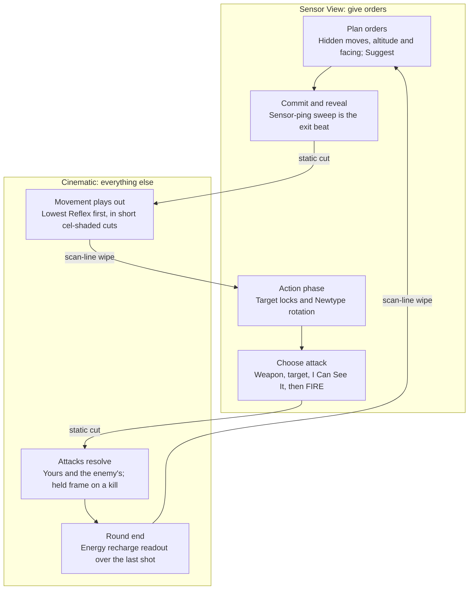

# No Haven on Earth — Art Direction: Sensor Feed × OVA Cinematic — 17 October 2026

This is the canonical art direction for the project. It replaces the online draft (claude.ai artifact), which agents cannot open.

**23 October rendering update:** [OVA rendering setup](ova-rendering.md) records the implemented desktop Forward+ path, masked depth/normal ink, painterly wet dock, film stack, held animation and remaining UV/lightmap work. Its implementation details supersede the earlier notes below.

## Vision and pillars

The player plans on a cockpit sensor display and watches the results play out as a 1996 OVA. Two visual modes share one battlefield. **Sensor View** is where every decision is made: it is quiet, monochrome and built only for reading. **Cinematic** is where those decisions pay off: cel-shaded, humid, heavy and loud.

The touchstone is *Mobile Suit Gundam: The 08th MS Team*. We take its grounded field-war tone, its jungle and monsoon settings, its hovertruck sound-sensor scenes, and mobile suits that read as worn military equipment, not heroes. The factions and machines are our own; only the tone and the technology level come from the One Year War.

**Pillars**

1. **Readability first.** If a choice between mood and clarity comes up during planning, clarity wins. Mood belongs to Cinematic.
2. **Grounded weight.** Mechs are heavy machines. They sink into the ground, splash, throw up dust and shake the camera. Nothing floats unless it is flying.
3. **Sensors as drama.** Information arrives the way it does for a field crew: pings, sweeps, contacts resolving out of noise. Reveals are events.
4. **90s OVA heart.** Hand-drawn values, hard sunsets, painted skies, film grain. It should look like a cel, not a modern anime game.

## Setting and tech level

Two original factions fight with One Year War-level technology. No Gundam designs are copied. We borrow the era's engineering logic and the 08th tone, so the machines feel like the first generation of mobile suits: heavy, exposed and mostly armed with shells.

| Faction | Inspired by | Shape language | Paint | Sensor eye |
| --- | --- | --- | --- | --- |
| Blue | Federation | Boxy, flat armour plates, squared shoulders, utilitarian, mass-production simple | Off-white, blue-grey, small red accents | Visor for line units; twin eyes for the ace only |
| Red | Zeon | Rounded, curved armour, exposed power pipes, heavy shoulder guards, more menacing | Olive, dark green, purple-grey accents | Single lens on a track, glowing |

**What the tech level means for the art**

- **Beam weapons are rare.** Only the ace and a few elite units carry them, so beams should look exceptional. Most fire is solid ammunition: machine guns, bazookas, cannons, railguns and missiles. Effects lean on tracers, muzzle smoke, shell casings and ricochet sparks.
- **Radar is unreliable.** Interference keeps fights short-range and visual. Sensors work by sound and heat, which is exactly what Sensor View shows: sound-sensor sweeps and heat contacts, not a clean modern radar.
- **Early-generation machinery.** Exposed hydraulics and joints, visible bolts and hatches, cockpit hatches in the chest, and dated CRT cockpit displays.
- **Nothing later than the era.** No transforming mechs, remote weapons or psychic-tech glow. Newtype effects stay subtle (see Transitions, cues and HUD).
- **Support vehicles match the era too:** hovertrucks, tanks, jeeps and chunky jet fighters.

## The two modes

The rule is simple: **Sensor View while the player is giving orders, Cinematic for everything else.** Planning, the Action phase (locks and Newtype rotation) and choosing attacks are orders. Movement, every attack (the player's and the enemy's), enemy actions and round end play in Cinematic. Mode switches always use the same two effects.

One round, top to bottom. Arrows that cross between the two groups are mode switches.

- **The reveal is the bridge.** Committing orders is the last thing the player does. The sensor-ping reveal plays on Sensor View as the exit beat, then cuts straight into Cinematic movement.
- **No flicker.** Consecutive activations that need no player input play as one Cinematic sequence. Enemy actions, such as a lock-on, appear as a short reticle shot inside that sequence rather than a separate switch.
- **Attacks alternate.** Each player FIRE cuts to Cinematic for that shot and returns to Sensor View for the next choice. Enemy attacks between player activations join the same sequence.
- **Round end is Cinematic.** Energy recharge plays as a readout over the last shot, then the scan-line wipe returns to planning.
- **Opt-out.** The player can turn Cinematic off. The game then resolves on Sensor View, with the overlays animating instead.

## Sensor View

Sensor View is a tactical display drawn on a dark phosphor screen. The world is reduced to geometry, and only units and orders carry colour. It should feel like the hovertruck's monitor, cleaned up enough to play on for an hour.

**Screen and post-processing**

- Background: near-black with a green-grey cast, never pure black.
- Base ink: one phosphor green for terrain and grid, at low intensity.
- Subtle scanlines and a slight vignette. Turn both off at high zoom and keep them under 5% contrast so they never cross a label.
- No film grain, bloom or depth of field in this mode. The image must be sharp.
- Optional faint noise that "settles" when a contact is revealed. Off by default once the player is familiar with it.

**Terrain**

- Ground is a contour surface: thin contour lines at every rule-height step, a faint coordinate grid at 1 rule unit, and a bolder line every 5 units.
- Buildings and hard cover are extruded wireframe blocks with a dim solid fill. Tall cover gets a brighter top edge than low cover, so cover height reads from above.
- Forest is a hatched area with a dotted outline, not individual trees.
- Water is a horizontal hatch, as on a map.
- Terrain never uses the faction or overlay colours.

**Units**

- Units render as the same 3D model, with a flat unlit fill and a bright outline in their faction colour. No textures, no shading ramp.
- Every unit sits on its base disc, which carries a facing chevron, the faction ring and the status pips (see Units and models).
- Airborne units keep their vertical tether and a ground marker that shrinks with altitude band.
- Unrevealed enemy orders show as a pulsing contact blip at the last known position, not as a model.

**Overlays**

- The existing colour meanings stay: amber for the current draft, cyan for confirmed Blue orders, salmon for revealed Red orders, gold for selection, red for legal targets. (See the colour clashes below for the hues that change.)
- Arcs and ranges are drawn as a sensor sweep: a thin bright edge with a soft fill under 15% opacity.
- Out-of-arc targets show the angle needed, for example "+15°", and a Newtype icon when Will can bring them in. This answers point 1 of [mock-battle-feedback.md](mock-battle-feedback.md).
- Line of sight is a dashed line that breaks and turns grey where it is blocked.

**Limits**

- No more than four saturated hues on screen at once, overlays included.
- No text smaller than 12 px at 1080p.

## Cinematic mode

Cinematic is a 1990s OVA cel brought into 3D: flat colour, crisp ink, painted skies and a hard key light. It plays whenever the rules are resolving, so it can trade some clarity for mood. The overlays still appear here, but quieter.

**Shading**

- Two-tone cel shading on units: a lit tone and one shadow tone with a hard edge. A third, darker tone is allowed for deep crevices and under-armour.
- Shadow tones shift cool (toward blue-violet), never just a darker version of the base colour. This is the single biggest cue for a hand-painted look.
- A thin, sharp specular highlight on armour edges, painted as a shape rather than a glossy blob.
- Ink outlines: about 1.5 px at 1080p on silhouettes, thinner on interior panel lines. Line colour is a dark version of the local colour, not pure black.
- Rim light in a warm colour on the side opposite the key light, to separate units from busy backgrounds.

**Lighting and time of day**

- One hard key light. Prefer low sun angles: late afternoon, sunset, overcast monsoon light, and night lit by flares.
- Shadows are hard-edged and cast in a colour, not grey.
- Each map picks one lighting preset and keeps it all battle.

**Sky and backgrounds**

- Painted skybox in the style of OVA background art: towering cumulus, layered haze, distant blue ridgelines.
- Distant terrain fades into a coloured atmospheric haze that matches the sky.

**Weather and effects**

- Rain as streaks with occasional splash sprites, fog bands at mid-height, and heat shimmer on hot maps.
- Effects are drawn shapes: cel-style explosions with two or three flat colours and black smoke shapes, beam shots as solid cores with a soft halo, and smear frames on fast motion.
- Footfalls throw dust or water. Landings shake the camera briefly.

**Camera**

- Short cuts, 1–3 seconds each: a low angle looking up at a mech as it moves, a follow shot behind a shoulder, a cut to the target as it is hit.
- Use the static "held frame" OVA trick for big moments: freeze on a detailed frame for half a second at the moment of impact.
- Always offer a skip, and a setting for "tactical camera only" playback.

**Post-processing**

- Light film grain, slight colour bleed at the edges, and a gentle bloom on beams and explosions only.
- An optional 4:3 safe frame or letterbox during cuts for a period feel.

## Colour and value system

Each colour carries one meaning in both modes, and the brightest values are reserved for what the player acts on. In order from quietest to loudest: terrain, then unit paint, then faction marks, then overlays.

**Value rules**

- Terrain sits in the middle of the value range with low saturation in both modes.
- Unit paint has more contrast than terrain but stays below overlay saturation.
- Only overlays and faction marks are fully saturated.
- Test every screen in greyscale. Units must separate from terrain and overlays must separate from units.

**Tokens.** "Current" is what the prototype uses today. "Proposed" values are starting points to tune in the style test.

| Token | Meaning | Current | Proposed | Where |
| --- | --- | --- | --- | --- |
| `sensor.bg` | Sensor screen background | `09121f` | `0a120e` | Sensor |
| `sensor.ink` | Terrain lines, grid | various greys | `3f7a5a` at 40–70% | Sensor |
| `faction.blue` | Blue faction units, confirmed orders | `57d5ef` / `63d8ed` | `57d5ef` (unify) | Both |
| `faction.red` | Red faction units, revealed orders | `f48478` | `e8735f` | Both |
| `overlay.draft` | Current draft path and ghost | `f3c378` | `f3c378` | Both |
| `overlay.select` | Selected unit | `f3c378` | `fff1c9` (pale gold, thicker ring) | Both |
| `overlay.target` | Legal target ring | `f48478` | `ff4fa3` (magenta) | Both |
| `overlay.invalid` | Illegal move | `ff586b` | `ff3b3b` with a hatched pattern | Both |
| `overlay.arc` | Weapon arc and range | `66d9f2` approx. | `d8ffe8` (sensor white-green) | Both |
| `paint.blue` | Blue faction armour | — | off-white `d9d4c4`, blue-grey `5b6d82`, red accent `a8483a` | Cinematic |
| `paint.red` | Red faction armour | — | olive `5f6e3f`, dark green `3b4630`, purple-grey accent `5a4f63` | Cinematic |

Where the current values live: faction colours in [units/presentation/unit_actor.gd](../units/presentation/unit_actor.gd) (line 26), [movement/presentation/movement_preview.gd](../movement/presentation/movement_preview.gd) (line 5) and [ui/battle_ui.gd](../ui/battle_ui.gd) (lines 4–7); selection and target rings in `units/presentation/unit_actor.gd` (lines 39–40); draft and invalid colours in `movement/presentation/movement_preview.gd` (line 7); arc colours in [combat/presentation/targeting_overlay.gd](../combat/presentation/targeting_overlay.gd) (lines 22–28); background in [battle/interaction/battle_controller.gd](../battle/interaction/battle_controller.gd) (line 56).

**Clashes in the current build**

- The Red faction colour and the legal-target ring are the same `f48478`. A targeted Red unit looks no different from an untargeted one. The target ring needs its own hue; magenta is proposed.
- The arc overlay is close to the Blue faction cyan, so a Blue unit's arc and a Blue order read as the same thing. Arcs move to a neutral sensor white-green.
- Draft and selection share the same gold. Selection becomes paler and thicker.

**Faction paint in Cinematic**

Unit armour uses muted military paint, not the faction marks. The Blue faction is off-white and blue-grey; the Red faction is olive and dark green. The saturated cyan and red stay on the base rings and the overlays. This keeps the 08th look and stops the jungle turning into a colour soup.

## Units and models

One model per unit serves both modes. Sensor View swaps its material, while the mesh, silhouette and base stay the same, so the player never has to re-identify a unit after a mode switch.

**Silhouette**

- Every unit must be identifiable as a solid black shape from the default tactical camera. Test this before texturing.
- Each role gets a distinct outline: the Blue ace has a tall head fin, twin eyes and a large backpack, ground mechs have wide shoulders and a squat stance, aircraft are flat delta shapes, tanks are low and long.
- Exaggerate heads, shoulders and weapons by 10–20% beyond realistic proportions, as tabletop miniatures do. Weapons should stick out past the body outline so facing reads from the model alone.
- Avoid thin parts under about 4 px at default zoom. They shimmer and disappear.

**Bases**

The base disc is the information panel. It is always visible and identical in both modes.

- Outer ring in the faction colour.
- A facing chevron at the front edge, larger than you think it needs to be.
- Status pips around the rim for Structure, Energy and Will. Locks show as a small reticle icon.
- Selection and target rings sit outside the faction ring so they never cover it.
- In Cinematic the base fades to about 30% opacity, and back to full when the camera returns to tactical.

**Altitude**

Three cues together, so no single cue has to carry it:

1. The existing vertical tether from model to base.
2. A ground shadow that gets smaller and softer at Low and smaller again at High.
3. A band marker on the tether: one tick for Low, two for High. This replaces the need to read the caption.

**Weathering and detail**

- Paint chips, mud splashes up to the knees, stencilled unit numbers and a faded faction emblem on the shoulder.
- Weathering is generated, not hand-painted: a mud gradient from the feet up and edge wear from baked vertex colour, both applied in the Godot shader (see Model production). It stays as flat shapes so it survives cel shading.
- Keep panel lines few and bold. Fine detail turns into noise at tactical zoom.

**Model production (Blender, built by Codex)**

Codex builds every model in Blender. The specs below are written so each one can be generated by a script and checked by a script rather than by eye.

- **Scripted builds.** Each model is a Blender Python script in the repo that builds the scene and exports a `.glb`. Rebuilds are repeatable and changes review as diffs.
- **Hard-surface kitbash.** Bevelled boxes, cylinders and wedges, with a 1–2 segment bevel so the cel shader catches the edges. No sculpting.
- **Rigid parts.** Torso, head, arms, legs and weapons are separate named objects in a parent hierarchy, with no skinning. Godot animates them procedurally.
- **Flat albedo and named slots.** Keep `armour_primary`, `armour_secondary`, `accent`, `frame` (joints), `sensor` (eye, emissive) and `weapon` for recolouring. Use albedo trim sheets for panel lines, stencils, caution tape and hard chips; avoid PBR detail channels. Existing models retain their modelled markings alongside automatically mapped panel trims. See [the starter trim atlas](ova-rendering.md).
- **Baked vertex colour.** Bake curvature and ambient occlusion into vertex colour in Blender. The shader uses them for edge wear and crevice shadow.
- **Origin and scale.** Origin at the centre of the base on the ground. Match the heights of the current primitive models in [units/presentation/unit_actor.gd](../units/presentation/unit_actor.gd).
- **Facing.** The prototype models face −Z. Godot treats +Z as the front of imported glTF models, so either model facing Blender +Y or rotate the imported scene 180°. Decide on the first test export and record it here.
- **Budget.** Mobile suits 3–8k triangles; vehicles and aircraft 1.5–4k. No normal maps.
- **Automated checks per model.** A black-silhouette render from the tactical camera plus three other angles, the triangle count, the material slot names, and origin and facing. Renders are saved to `artifacts/` for review.

## Terrain and environment

Terrain is a stage, not a character: it supports the units and must never compete with them. Every piece of terrain has a rules meaning, and its look should say which one.

**Biomes, in rough priority order**

| Biome | 08th reference | Lighting preset | Signature props |
| --- | --- | --- | --- |
| Jungle river valley | The Southeast Asian front | Humid late afternoon, haze | Broad-leaf canopy, river, rope bridges |
| Ruined town | Village and outpost fights | Overcast, rain | Collapsed concrete, power poles, rusted vehicles |
| Mountain pass | Snow and high-altitude episodes | Cold, low sun | Rock spires, fog banks, snow patches |
| Red faction base perimeter | The final assault on a fortified mountain base | Night, floodlights, flares | Bunkers, fuel tanks, searchlights |

**Cover readability**

- Low cover (walls, wrecks, rubble) stays below mech waist height. Heavy cover (buildings, rock spires) is clearly taller than a mech.
- In Cinematic, cover keeps its silhouette clean: no foliage hanging over the top edge of blocking terrain.
- Wrecks get a scorched decal and the existing "+1 cover" label.
- Decorative props that have no rules effect stay small and low and never match the shape of cover.

**Foliage**

- Trees and jungle are painted cards and clusters in two or three flat tones, in the style of OVA background art.
- Foliage near units fades or cuts away when it would hide a model from the tactical camera.

**Ground**

- Hand-painted ground textures with large, simple shapes: mud, grass, gravel, puddles. No noisy photo textures.
- Mechs leave footprints and wet tracks during Cinematic; they fade after a round.

## Transitions, cues and HUD

A mode switch takes no more than 0.4 seconds and is always the same effect, so the player learns it once and stops noticing it.

**Switching effects**

- **Into Sensor View:** a horizontal scan line wipes across the screen. Colour drains behind it and the contour lines draw on.
- **Into Cinematic:** a brief burst of static, then a hard cut to the first camera shot.
- The tactical camera position is shared, so returning to Sensor View lands exactly where the player left it.

**Signature cues**

- **Order reveal (the sound-sensor ping):** a radial sweep ring expands from each Blue unit. Hidden enemy contacts resolve into their models and orders as the ring passes them, with a sonar ping for each. This turns the existing reveal step into the 08th sensor moment.
- **Lock acquired:** a reticle closes on the target with a short two-tone beep.
- **Newtype Reflexes:** a single white flash outline on the ace and a short, high chime, used only for Will powers.
- **Unit destroyed:** in Cinematic, a held frame on the explosion; in Sensor View, the contact breaks into noise and leaves a static "LOST" marker.

**HUD**

- The HUD is the field crew's monitor bezel in both modes: dark panels, monospaced labels in capitals, thin rules, and small status lamps.
- In Sensor View the HUD is fully visible. In Cinematic it shrinks to the initiative bar and a one-line telemetry ticker, so the shots have room.
- Dice results appear as a printed readout strip, like a teleprinter, with rerolled dice marked as now.
- Fonts: a condensed monospace for numbers and labels, and a plain sans for longer text. All UI text at least 12 px at 1080p.

## Godot 4 implementation notes

One global shader parameter, `sensor_mix` (0 = Cinematic, 1 = Sensor), drives both modes. Every unit and terrain shader reads it, so a mode switch is a single tween with no material swapping and no scene reload.

**Mode switch**

- Register `sensor_mix` as a global shader uniform in Project Settings, and set it with `RenderingServer.global_shader_parameter_set()`.
- Swap the `WorldEnvironment` between two `Environment` resources: Cinematic (sky, fog, glow, tonemap) and Sensor (flat background, no fog or glow).
- Screen effects (scanlines, vignette, grain, static) are one full-screen `ColorRect` on a `CanvasLayer`, with a canvas shader that also reads `sensor_mix`.

**Unit shader (spatial)**

- Cel shading in the `light()` function: step the N·L term into two or three bands, tint the shadow band toward a cool colour uniform, and add a rim term from the view angle.
- Outlines with the inverted-hull method: a `next_pass` material with `cull_front` that pushes vertices out along their normals. It is cheap and works on the existing primitive models. A screen-space edge pass using the Godot 4.3+ `Compositor` is the upgrade path if hull outlines look patchy.
- With `sensor_mix` at 1, skip lighting and output a flat dark fill, and set the outline to the faction colour.

**Terrain shader**

- Contour lines from world height: `fract(world_y / step)` and a screen-space derivative (`fwidth`) for even line thickness at any zoom.
- Grid lines from world X and Z the same way, with a bolder line every 5 units.
- Blend from the painted ground texture (Cinematic) to contour and grid ink (Sensor) by `sensor_mix`.

**Render order and layers**

- Overlays (arcs, paths, rings) render unshaded, with no depth test against terrain, on their own visual layer. They must never be fogged, tone-mapped or outlined.
- Labels use `Label3D` with `no_depth_test` and fixed screen size, as now.

**Performance targets**

- 60 fps at 1080p on a mid-range GPU with six units, one map and rain on.
- Keep the inverted hull to units only. Terrain edges come from the contour shader instead.

## Readability checklist and next steps

Run this checklist on every new unit, map and overlay before it ships.

**Checklist**

- [ ] The unit is identifiable as a black silhouette from the default camera.
- [ ] Facing reads from the model and from the base chevron, each on its own.
- [ ] Altitude band reads without the caption (tether ticks plus shadow size).
- [ ] The screen passes a greyscale test: terrain < units < overlays.
- [ ] No terrain or paint uses a reserved overlay or faction colour.
- [ ] No more than four saturated hues on screen in Sensor View.
- [ ] All text is at least 12 px at 1080p.
- [ ] Cinematic playback can be skipped, and the tactical-only setting works.

**Do and don't**

| Do | Don't |
| --- | --- |
| Put information on bases and overlays | Hide information in model detail or texture |
| Cool, coloured shadows | Grey or black shadows |
| Flat painted weathering | Physically based roughness grime |
| One hard key light per map | Several competing light sources |
| Muted paint, saturated marks | Saturated armour colours |
| Short, skippable cuts | Long camera moves the player must sit through |

**Next steps**

1. Build a style-test scene: one existing unit with the cel and sensor shaders, one contour-shaded terrain patch, and the `sensor_mix` toggle.
2. Fix the colour clashes in the current build (target ring, arc colour, selection gold). These are cheap and help now.
3. Add the base chevron and the altitude tether ticks to the primitive models.
4. Prototype the sensor-ping reveal on the existing commit-orders step.
5. Write the first Blender build script with Codex for one Blue line mech. It sets the template for every later model: material slots, origin, facing and the automated silhouette renders.
6. Name the two factions and write a one-page design-language sheet for each, based on Setting and tech level.

**Decisions (answered 17 Oct 2026, reflected above)**

- **Does Cinematic play every round, or only for attacks and destroyed units?** Cinematic mode is used whenever you're not giving orders.
- **Should the Action phase (locks and Newtype rotation) stay in Sensor View, or cut briefly to Cinematic for Newtype?** Sensor View, as it involves giving orders.
- **Is the setting strictly the One Year War, or our own original factions with 08th-style design?** Original factions, but the setting is One Year War level of tech.
- **Who builds the models, and in which tool?** Models built in Blender by Codex.
